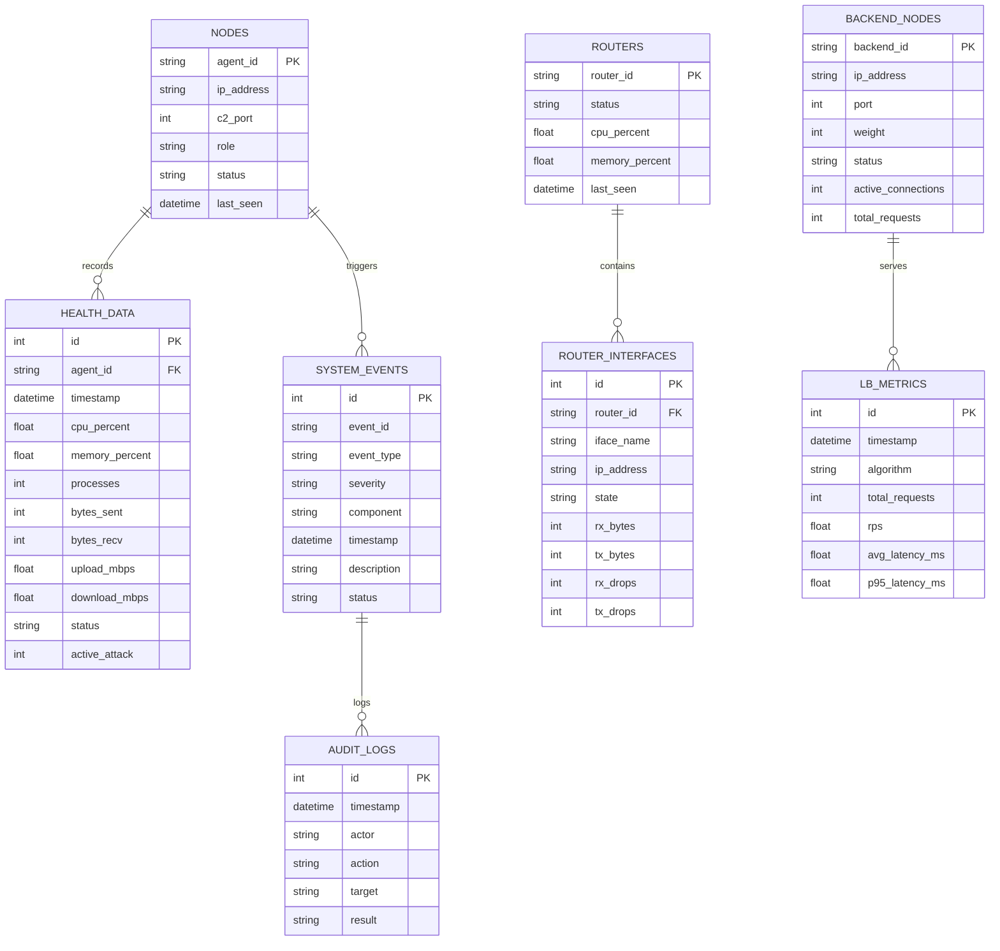
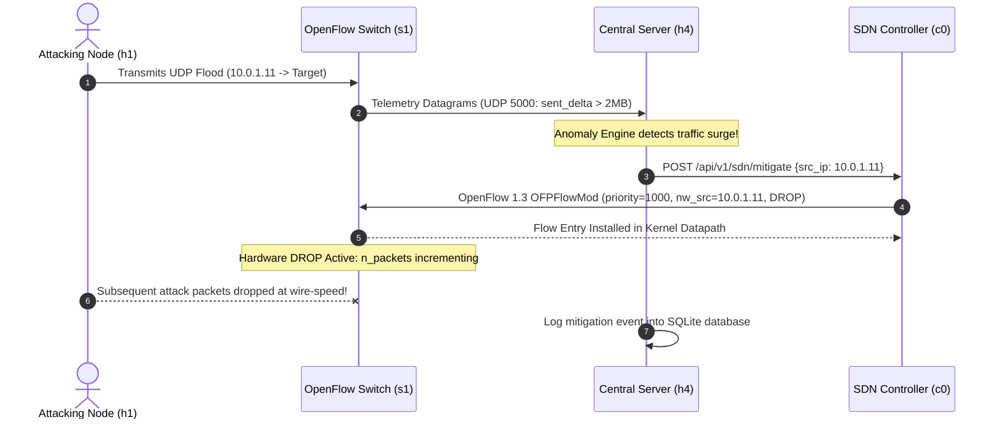

# 🌐 REMOTE NETWORK HEALTH MONITOR — SYSTEM ARCHITECTURE SPECIFICATION
**Version**: 2.0.0 (Enterprise NOC & Multi-Subnet SDN)  
**Date**: November 5, 2026  
**Document Classification**: Engineering Reference Specification  

---

## 1. Executive Summary & Purpose

The **Remote Network Health Monitor** is a centralized network intelligence, telemetry monitoring, traffic management, and automated remediation platform. It bridges distributed host-level and router-level telemetry with software-defined networking (OpenFlow 1.3) and custom application-level load balancing.

The system is engineered for dual operations:
1. **Continuous Observability**: Real-time distributed telemetry ingestion, accurate bandwidth throughput tracking ($Mbps$), router CPU/interface health monitoring, and deterministic anomaly detection.
2. **Active Network Control**: Automated OpenFlow hardware-level flow mitigation, custom HTTP reverse-proxy traffic balancing with dynamic backend failover, and controlled laboratory stress simulations.

---

## 2. Network Topology & Addressing Architecture

The infrastructure is partitioned into two distinct Layer 3 subnets connected via a dedicated Linux Layer 3 Router (`r1`) and controlled by an OpenFlow 1.3 Software-Defined Networking Controller (`c0`):

```
       [ Client Subnet: 10.0.1.0/24 ]                             [ Backend Subnet: 10.0.2.0/24 ]
 ┌────────────────────────────────────────┐                 ┌────────────────────────────────────────┐
 │ h1: Client 1 (10.0.1.11, Agent 1)      │                 │ h5: Backend Server 1 (10.0.2.11)       │
 │ h2: Client 2 (10.0.1.12, Agent 2)      │                 │ h6: Backend Server 2 (10.0.2.12)       │
 │ h3: Client 3 (10.0.1.13, Agent 3)      │                 │ h7: Backend Server 3 (10.0.2.13)       │
 │ h4: Monitor & Web UI (10.0.1.20:5050)  │                 └───────────────────┬────────────────────┘
 │ h8: Load Balancer (10.0.1.30:8000)     │                                     │
 └───────────────────┬────────────────────┘                                     │
                     │                                                          │
          ┌──────────┴──────────┐                                    ┌──────────┴──────────┐
          │  Open vSwitch s1    │                                    │  Open vSwitch s2    │
          │   (Client Switch)   │                                    │  (Backend Switch)   │
          └──────────┬──────────┘                                    └──────────┬──────────┘
                     │                                                          │
                     │  r1-eth0 (10.0.1.1)                  r1-eth1 (10.0.2.1)  │
                     └────────────────────┐                ┌────────────────────┘
                                          │                │
                                      ┌───┴────────────────┴───┐
                                      │  Linux Layer 3 Router  │
                                      │   (r1: ip_forward=1)   │
                                      └────────────────────────┘
                                                  ║
                                  OpenFlow 1.3 Control Channel (Port 6653)
                                                  ║
                                      ┌────────────────────────┐
                                      │  SDN Controller (c0)   │
                                      │ (REST API: Port 8080)  │
                                      └────────────────────────┘
```

### 2.1 IP Addressing & Gateway Plan

| Node / Interface | IP Address | Subnet Mask | Default Gateway | Primary Role |
|---|---|---|---|---|
| **h1** | `10.0.1.11` | `255.255.255.0` (`/24`) | `10.0.1.1` | Client Host 1 / Telemetry Agent / Traffic Generator |
| **h2** | `10.0.1.12` | `255.255.255.0` (`/24`) | `10.0.1.1` | Client Host 2 / Telemetry Agent / Traffic Generator |
| **h3** | `10.0.1.13` | `255.255.255.0` (`/24`) | `10.0.1.1` | Client Host 3 / Telemetry Agent / Traffic Generator |
| **h4** | `10.0.1.20` | `255.255.255.0` (`/24`) | `10.0.1.1` | Central Telemetry Ingestion, C2 Engine, Web Dashboard |
| **h8** | `10.0.1.30` | `255.255.255.0` (`/24`) | `10.0.1.1` | Custom Async HTTP Load Balancer (Reverse Proxy) |
| **r1-eth0** | `10.0.1.1` | `255.255.255.0` (`/24`) | N/A | Router Gateway Interface for Subnet 1 |
| **r1-eth1** | `10.0.2.1` | `255.255.255.0` (`/24`) | N/A | Router Gateway Interface for Subnet 2 |
| **h5** | `10.0.2.11` | `255.255.255.0` (`/24`) | `10.0.2.1` | Backend HTTP Microservice 1 (Port 8001) |
| **h6** | `10.0.2.12` | `255.255.255.0` (`/24`) | `10.0.2.1` | Backend HTTP Microservice 2 (Port 8002) |
| **h7** | `10.0.2.13` | `255.255.255.0` (`/24`) | `10.0.2.1` | Backend HTTP Microservice 3 (Port 8003) |
| **s1 Bridge** | `10.0.1.254` | `255.255.255.0` (`/24`) | N/A | Host OS Management Bridge to Subnet 1 |
| **c0 (SDN)** | `127.0.0.1` / `10.0.1.254` | N/A | N/A | OpenFlow Controller (OF: 6653, REST: 8080) |

---

## 3. Four-Plane Architectural Model

### 3.1 Telemetry & Agent Plane
- **Agents** running on each host (`h1`-`h3`, `h5`-`h7`) and router (`r1`) collect system metrics via `psutil` and network metrics via `/proc/net/dev`.
- **True Throughput Rate**: Bandwidth is calculated dynamically between consecutive sample timestamps ($t_{k}$ and $t_{k-1}$):
  $$\text{Upload Rate (Mbps)} = \frac{(\text{bytes\_sent}_k - \text{bytes\_sent}_{k-1}) \times 8}{(t_k - t_{k-1}) \times 1,000,000}$$
  $$\text{Download Rate (Mbps)} = \frac{(\text{bytes\_recv}_k - \text{bytes\_recv}_{k-1}) \times 8}{(t_k - t_{k-1}) \times 1,000,000}$$
- **Protocol**: Unicast UDP datagrams sent to `h4:5000` containing sequence number, node state, CPU, RAM, throughput rates, and packet error/drop counters.
- **Router Monitor**: Queries routing tables (`ip route`), interface statuses (`ip link`), ICMP latency, and packet drops.

### 3.2 Ingestion, Detection & Control Plane
- **Ingestion**: Server on `h4` binds UDP socket `0.0.0.0:5000`, validates payloads, updates in-memory registry, and writes to SQLite in WAL mode.
- **Anomaly Detection**: Evaluates incoming telemetry against rolling baselines and configurable thresholds:
  - CPU Utilization $> 85\%$ for $\ge 3$ samples $\rightarrow$ CRITICAL ALERT.
  - Ingress Throughput $> 2.0\text{ MB/s}$ or packet flood $\rightarrow$ ANOMALY DETECTED.
  - Router Packet Loss $> 5\%$ or interface DOWN $\rightarrow$ ROUTER CRITICAL.
- **Alert Lifecycle**: Tracks state transitions:
  $$\text{NORMAL} \longrightarrow \text{DETECTED} \longrightarrow \text{ACKNOWLEDGED} \longrightarrow \text{MITIGATING} \longrightarrow \text{RECOVERED}$$
- **Command & Control (C2)**: Authenticated TCP control channel with secret token verification (`C2_SHARED_SECRET`) for controlled stress execution.

### 3.3 Traffic Management & Load Balancing Plane
- **Custom Reverse Proxy**: Implemented in Python `asyncio` + `aiohttp` on host `h8` (`10.0.1.30:8000`).
- **Balancing Algorithms**:
  1. **Round Robin (RR)**: Deterministic modulo indexing across eligible healthy backends.
  2. **Least Connections (LC)**: Dynamically selects the backend with the minimum active in-flight HTTP requests.
  3. **Weighted Round Robin (WRR)**: Smooth round-robin distribution respecting configured capacity weights.
- **Health Checker**: Continuously polls upstream backends (`GET /health`) every 2 seconds. Automatically marks failing backends as unhealthy after 3 consecutive errors and removes them from rotation. Automatically restores them after 2 consecutive successes.
- **Backend Lifecycle**: Supports `ENABLE`, `DRAIN`, `DISABLE`, and `RESTORE` via REST API.

### 3.4 SDN & Data Plane
- **OpenFlow 1.3 Controller**: Exposes WSGI REST endpoints (`POST /api/v1/sdn/mitigate`, `POST /api/v1/sdn/unblock`, `GET /api/v1/sdn/stats`).
- **Hardware Flow Programming**: Interacts with Open vSwitch kernel datapaths on switches `s1` and `s2` using OpenFlow 1.3:
  $$\text{Priority } 1000, \text{ Match: } [\text{eth\_type}=0x0800, \text{ ipv4\_src}=\text{attacker\_ip}] \longrightarrow \text{Action: DROP}$$
- **Flow Verification**: Audits switch flow tables directly using `ovs-ofctl -O OpenFlow13 dump-flows` to confirm drop counters (`n_packets`, `n_bytes`) in the data plane.

---

## 4. Database Schema Specification

The storage engine uses SQLite with Write-Ahead Logging (`PRAGMA journal_mode=WAL;`).



---

## 5. End-to-End Operational Workflows

### 5.1 Real-Time Telemetry & Anomaly Mitigation Flow


### 5.2 Load Balancing & Backend Failover Flow
```mermaid
sequenceDiagram
    autonumber
    actor Client as Benign Client (h2)
    participant LB as Load Balancer (h8:8000)
    participant B1 as Backend 1 (h5:8001)
    participant B2 as Backend 2 (h6:8002)

    LB->>B1: Periodic GET /health (Status: 200 OK)
    LB->>B2: Periodic GET /health (Status: 200 OK)

    Client->>LB: GET /api/service
    Note over LB: Algorithm: Round Robin
    LB->>B1: Forward request
    B1-->>LB: 200 OK (Served by Backend 1)
    LB-->>Client: 200 OK

    Note over B2: Backend 2 process killed / network link down
    LB->>B2: GET /health (Connection Refused / Timeout)
    Note over LB: Consecutive Failures >= 3 -> Mark B2 UNHEALTHY

    Client->>LB: GET /api/service
    Note over LB: B2 excluded; auto-failover to B1
    LB->>B1: Forward request
    B1-->>LB: 200 OK (Served by Backend 1)
    LB-->>Client: 200 OK (Zero user disruption)
```
