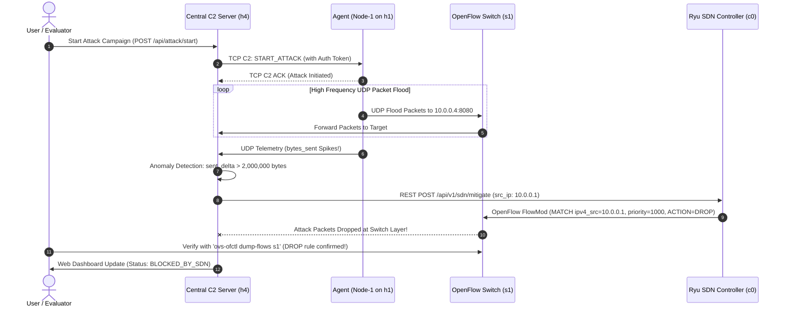

# 🌐 Network Health Monitoring & SDN Attack Simulation System Architecture

## 1. Problem Understanding & Executive Overview

Modern enterprise and cloud networks require real-time visibility into infrastructure health, dynamic anomaly detection, and automated mitigation capabilities. Traditional telemetry solutions often operate in isolation from network control planes, leading to delayed responses during Cyber-Attacks (such as Distributed Denial of Service - DDoS).

This system bridges **Socket-Based Distributed Telemetry** with **Software-Defined Networking (SDN)**:
* **Host Telemetry Agents** distributed across a **Mininet network topology** (`h1`, `h2`, `h3`) continuously report host-level health (CPU, RAM, Processes, Network Throughput) over lightweight **UDP sockets** (port 5000) to a Central Server running on host `h4` (`10.0.0.4`).
* A central **Command & Control (C2) Server** communicates over authenticated **TCP sockets** (ports 5001–5003) with agents to orchestrate automated attack campaigns (UDP packet floods). Commands require a shared secret token.
* When socket telemetry indicates an anomaly (byte rate flood or active attack flag), the server calls the **Ryu SDN Controller** via its WSGI REST API (`http://127.0.0.1:8080/api/v1/sdn/mitigate`).
* The Ryu controller pushes a hardware-level **OpenFlow 1.3 `OFPFlowMod` DROP rule** onto switch `s1` (`priority=1000`, `match ipv4_src=<attacker_ip>`), neutralizing the packet flood at the data plane switch layer.

---

## 2. System Architecture Diagram

```mermaid
graph TD
    subgraph Mininet OpenFlow Data Plane
        h1["Host Node 1 (Agent h1)<br>10.0.0.1 | C2: 5001"]
        h2["Host Node 2 (Agent h2)<br>10.0.0.2 | C2: 5002"]
        h3["Host Node 3 (Agent h3)<br>10.0.0.3 | C2: 5003"]
        h4["Host Node 4 (Server h4)<br>10.0.0.4 | Web: 5050"]
        s1["OpenFlow Switch (s1)<br>OpenFlow 1.3"]
    end

    subgraph SDN & Control Plane
        ryu["Ryu SDN Controller (c0)<br>OpenFlow: 6653 | REST API: 8080"]
        server["Central Monitoring & C2 Server (on h4)<br>UDP: 5000 | TCP C2 Client | Web: 5050"]
        db[("SQLite Database<br>(health.db - WAL Mode)")]
        web["Flask Web Dashboard<br>http://10.0.0.4:5050"]
    end

    h1 <-->|OpenFlow Data Plane| s1
    h2 <-->|OpenFlow Data Plane| s1
    h3 <-->|OpenFlow Data Plane| s1
    h4 <-->|OpenFlow Data Plane| s1
    
    s1 <==>|OpenFlow 1.3 Protocol| ryu

    h1 -->|UDP Health Telemetry (5000)| server
    h2 -->|UDP Health Telemetry (5000)| server
    h3 -->|UDP Health Telemetry (5000)| server

    server <==>|Authenticated TCP C2 (Token Protected)| h1
    server <==>|Authenticated TCP C2 (Token Protected)| h2
    server <==>|Authenticated TCP C2 (Token Protected)| h3

    server <==>|REST Mitigation Calls| ryu
    server <--> db
    web <--> server
```

---

## 3. Communication Protocols & Payload Specifications

### 3.1 UDP Telemetry Protocol (Agent ➔ Server)
Agents transmit telemetry JSON packets to UDP Port `5000` on server host `10.0.0.4` every 3 seconds.

* **Transport**: UDP
* **Target**: `10.0.0.4:5000`
* **Format**: JSON
* **Sample Payload**:
```json
{
  "agent_id": "Node-1",
  "ip_address": "10.0.0.1",
  "c2_port": 5001,
  "timestamp": "2026-10-10 23:30:00",
  "cpu_percent": 14.5,
  "memory_percent": 42.1,
  "processes": 120,
  "bytes_sent": 1048576,
  "bytes_recv": 524288,
  "status": "NORMAL",
  "active_attack": false
}
```

### 3.2 TCP Command & Control (C2) Protocol (Server ↔ Agent)
The server maintains bi-directional TCP socket connections on ports `5001`, `5002`, `5003`. All commands require a shared secret authentication token (`C2_SHARED_SECRET`).

* **Transport**: TCP
* **Security**: Token-based authentication (`"token": "sdn_cn_c2_token_secret_2026"`)
* **Command Types**:
  1. `START_ATTACK`: Initiates a UDP packet flood from the agent toward a target IP.
  2. `STOP_ATTACK`: Immediately terminates the attack thread on the agent.
  3. `STATUS`: Queries active node state and thread health.

* **Sample Command Payload (Server ➔ Agent)**:
```json
{
  "command": "START_ATTACK",
  "token": "sdn_cn_c2_token_secret_2026",
  "target_ip": "10.0.0.4",
  "target_port": 8080,
  "duration": 15,
  "packet_size": 1024
}
```

* **Sample Response Payload (Agent ➔ Server)**:
```json
{
  "status": "SUCCESS",
  "message": "DDoS flood attack initiated on 10.0.0.4:8080 for 15s",
  "agent_id": "Node-1"
}
```

* **Unauthorized Rejection Payload (Missing / Invalid Token)**:
```json
{
  "status": "ERROR",
  "message": "Unauthorized: Invalid or missing C2 token"
}
```

### 3.3 Ryu SDN Controller REST API Specifications
* **Port**: `8080` (WSGI Application)
* **Endpoints**:
  * `GET /api/v1/sdn/stats`: Returns connected switch DPID, active flow count, and blocked IP list.
  * `POST /api/v1/sdn/mitigate`: Installs OpenFlow 1.3 `OFPFlowMod` matching `eth_type=0x0800, ipv4_src=src_ip` with `priority=1000, instructions=[]` (DROP).
  * `POST /api/v1/sdn/unblock`: Deletes the drop rule using `OFPFC_DELETE_STRICT`.

---

## 4. Socket–SDN Integration & Automated Mitigation Workflow



---

## 5. Deliverable Rubric Mapping Matrix

| Rubric Item | Weight | Solution Implementation | File Reference |
| :--- | :---: | :--- | :--- |
| **Problem Understanding & Architecture** | **2 pts** | Comprehensive design document, sequence diagrams, protocol definitions, and topology layout. | [`architecture.md`](file:///d:/CN/architecture.md) |
| **TCP/UDP Socket Implementation** | **4 pts** | Dual-socket system: UDP for high-performance telemetry; TCP with shared-secret token authentication for reliable Command & Control and packet flooding. | [`agent.py`](file:///d:/CN/agent.py), [`server.py`](file:///d:/CN/server.py) |
| **Mininet + SDN Implementation** | **4 pts** | Custom Mininet OpenFlow topology script running server inside `h4` and agents inside `h1-h3`, coupled with real Ryu OpenFlow 1.3 controller with L2 learning forwarding. | [`topology.py`](file:///d:/CN/topology.py), [`ryu_sdn_controller.py`](file:///d:/CN/ryu_sdn_controller.py) |
| **Socket–SDN Integration** | **3 pts** | Server detects socket volume anomalies in real time, issues REST call to Ryu WSGI interface, installing real OpenFlow `DROP` rule verifiable via `ovs-ofctl dump-flows s1`. | [`server.py`](file:///d:/CN/server.py), [`ryu_sdn_controller.py`](file:///d:/CN/ryu_sdn_controller.py) |
| **Initial Testing & Demo** | **2 pts** | Automated 5-stage evaluation test runner + real-time dark-theme Flask web dashboard with live Chart.js charts and campaign controls. | [`demo_runner.py`](file:///d:/CN/demo_runner.py), [`templates/index.html`](file:///d:/CN/templates/index.html) |

---

## 6. End-to-End Execution Guide

### Step 1: Start Ryu SDN Controller (Terminal 1)
```bash
ryu-manager ryu_sdn_controller.py --wsapi-port 8080
```

### Step 2: Start Mininet Network Topology (Terminal 2, as root)
```bash
sudo python3 topology.py
```
* Mininet boots `h1`, `h2`, `h3`, `h4`, and switch `s1`.
* `server.py` automatically launches on `h4` (`10.0.0.4:5050`).
* `agent.py` automatically launches on `h1`, `h2`, `h3`.
* Switch interface `s1` is assigned `10.0.0.254/24` to allow host OS browser access.

### Step 3: Run the Verification Test Suite (Terminal 3)
```bash
python3 demo_runner.py
```
Executes all 5 verification stages and outputs a structured PASS/FAIL matrix:
1. `[PASS]` UDP Telemetry collection from 3 host nodes (`h1-h3`).
2. `[PASS]` Authenticated TCP C2 command dispatch with shared secret token.
3. `[PASS]` Server-side byte rate traffic flood anomaly detection.
4. `[PASS]` Ryu Controller REST `/api/v1/sdn/mitigate` execution.
5. `[PASS]` Switch `s1` data-plane `DROP` rule verification via `ovs-ofctl dump-flows s1`.

### Step 4: Open Web Dashboard
Navigate in your host browser to:
* **`http://10.0.0.4:5050`** (or `http://localhost:5050` if port-forwarded)
